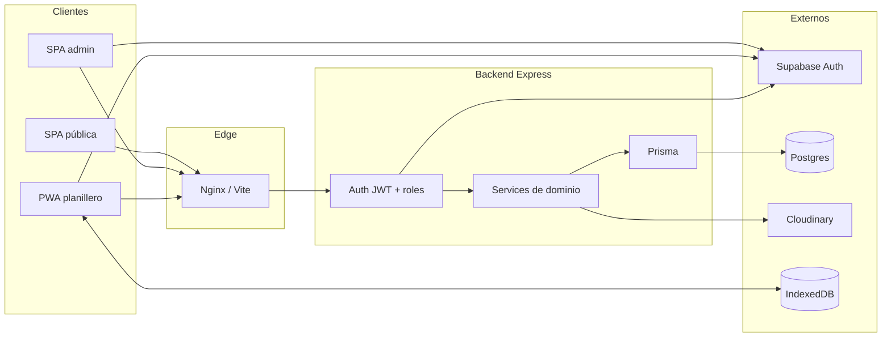

# Liga Gestión — Análisis completo para portfolio

**Proyecto:** Sistema de gestión para una liga municipal de básquet  
**Repo:** monorepo `liga-gestion`  
**Fecha del análisis:** 11 de agosto de 2026  
**Alcance:** código fuente, arquitectura, dominio, seguridad, deploy, tests y deuda técnica

---

## 1. Resumen ejecutivo

**Liga Gestión** es una aplicación full-stack para administrar una liga de básquet de punta a punta: catálogo (clubes, categorías, temporadas, jugadores, equipos), competencia (torneos, inscripciones, zonas, fixture, playoffs), planillaje en vivo con soporte offline (PWA), estadísticas públicas y operaciones administrativas (cierres forfeit/no-show, auditoría, firmas digitales, comprobantes).

No es un CRUD genérico: el valor está en el **dominio deportivo** (reglas de cuartos, faltas, timeouts, OT, elegibilidad por edad/sexo, traspasos con permanencia mínima, desempates de tabla, avance automático de brackets) y en la **arquitectura** (backend como única fuente de verdad de negocio, contratos Zod compartidos, planilla offline-first con claim exclusivo de mesa).

### Tres superficies en una SPA

| Superficie | Rutas | Usuario |
|------------|-------|---------|
| **Pública** | `/`, torneos, equipos, box-score, jugadores, documentos | Aficionados / clubes |
| **Admin** | `/admin/*` | Organización de la liga |
| **Planillero** | `/planillero`, `/planilla/:matchId` | Scorers en mesa (PWA offline) |

### Métricas aproximadas del código propio

| Área | LOC (aprox.) |
|------|--------------|
| Backend (`apps/backend/src`) | ~12.000 |
| Frontend (`apps/frontend/src`) | ~18.400 |
| Contratos compartidos (`packages/shared`) | ~1.900 |
| Schema Prisma | ~600 |
| Migraciones SQL | 14 |
| Tests propios (backend + frontend) | ~25 archivos |

---

## 2. Problema que resuelve

Una liga municipal necesita:

1. **Padrones** de jugadores con sexo, edad, club y historial de pases.
2. **Equipos por categoría/temporada**, plantillas base y rosterms de torneo.
3. **Torneos** con formatos distintos (regular, playoffs, regular+playoffs, zonas+knockout).
4. **Fixture y llaves** generados sin romper partidos ya jugados.
5. **Planilla oficial** en cancha, a menudo **sin internet estable**.
6. **Resultados, posiciones y estadísticas** públicos y confiables.
7. **Operaciones excepcionales**: forfeit, no-show, liberación de mesa, firmas, comprobantes de inscripción.

La solución concentra reglas de negocio en un API Express + Prisma, autentica con Supabase Auth, persiste en Postgres (Supabase) y entrega una PWA de planillaje con IndexedDB (Dexie) + sync diferido.

---

## 3. Stack tecnológico

### Monorepo (npm workspaces)

```
liga-gestion/
├── apps/frontend     # React SPA
├── apps/backend      # API Express
├── packages/shared   # Zod schemas, enums, helpers de dominio
├── packages/db       # Prisma schema + client
├── supabase/         # Migraciones SQL, seed, edge functions legacy
├── deploy/           # Docker + nginx
├── scripts/          # Seeds, architecture check, utilidades DB
└── .github/workflows # CI + keepalive Supabase
```

### Frontend

| Tecnología | Uso |
|------------|-----|
| React 19 | UI |
| TypeScript | Tipado estricto |
| Vite 8 | Build / dev server |
| React Router 7 | Routing SPA |
| TanStack Query 5 | Cache / mutaciones admin y público |
| Tailwind CSS 3 | Estilos + design tokens |
| Zustand | Estado vivo del tablero de planilla |
| Dexie (IndexedDB) | Persistencia offline de setup, eventos, firmas, prefetch |
| Supabase JS | Solo Auth/sesión (no mutaciones de dominio) |
| jsPDF | Export de planilla oficial |
| signature_pad | Captura de firmas en canvas |
| Service Worker manual + Web Manifest | PWA instalable (`start_url: /planillero`) |

### Backend

| Tecnología | Uso |
|------------|-----|
| Express 4 | HTTP API REST |
| TypeScript | Tipado |
| Zod | Validación de env, bodies, queries |
| Prisma | ORM + transacciones |
| Supabase JS (service role) | Validación JWT / claims |
| Helmet + CORS + Morgan | Hardening HTTP y logs |
| Cloudinary SDK | Firmas de upload / signed URLs / destroy |
| Vitest + Supertest | Unit e integration tests |
| zod-to-json-schema | OpenAPI parcial |

### Infra / datos

| Pieza | Rol |
|-------|-----|
| Supabase Postgres | Base de datos |
| Supabase Auth | Identidad (email/password) |
| Supabase Storage | Histórico / no es el path principal de media hoy |
| Cloudinary | Logos, comprobantes de inscripción, firmas de partido |
| Docker Compose | Backend + frontend nginx |
| GitHub Actions | CI (lint, build, unit, architecture) |

---

## 4. Arquitectura

### Principio rector

> **El frontend no toma decisiones de negocio.** Las mutaciones de dominio pasan por el backend. Supabase Auth solo identifica usuarios; la autorización de dominio la resuelve Express leyendo `user_roles`.

### Capas del backend (feature-based)

Cada módulo en `apps/backend/src/features/<módulo>/` sigue:

```
*.routes.ts → *.controller.ts → *.service.ts → *.repository.ts
(+ *.errors.ts, tests)
```

Módulos: `admin`, `audit`, `auth`, `brackets`, `categories`, `clubs`, `eligibility`, `enrollments`, `fixtures`, `groups`, `matches`, `media`, `players`, `public`, `rosters`, `scoring`, `seasons`, `standings`, `teams`, `tournaments`.

Infra transversal:

- `auth/` — middleware JWT + roles
- `http/` — validate, errors, OpenAPI, requestId, asyncHandler
- `db/` — Prisma client + helper de transacciones
- `config/env.ts` — env tipado con Zod
- `lib/` — tokens, algoritmos de fixture, paginación

### Boundary enforcement automatizado

`scripts/check-architecture.mjs` (corre en CI) impone:

1. Prisma solo en repositories o infra `db/` / `test/`
2. Express no en services/repositories
3. Express fuera de features solo en http/auth/app/server
4. Schemas Zod de dominio no en `features/` → deben vivir en `packages/shared`

### Contratos compartidos (`@liga/shared`)

Paquete con **solo Zod** y helpers puros: schemas de create/update, enums, reglas de elegibilidad, import de jugadores (parse TSV/CSV), reglas de cuartos, foul helpers, fixtures/groups/brackets/standings/media/admin/public.

Frontend y backend importan los mismos schemas → menos drift entre UI y API.

### Flujo de datos (alto nivel)



### Deploy

- `deploy/docker-compose.yml`: servicios `backend` + `frontend` en red `liga`
- Frontend: build Vite → imagen `nginx:1.27-alpine`, proxy `/api/` y `/health` al backend
- Host example: reverse proxy + plantilla HTTPS (certbot)
- Puerto publicado: `127.0.0.1:3006:80`

---

## 5. Modelo de dominio

### Entidades principales

**Identidad / permisos**

- `profiles` — perfil ligado al UUID de Auth
- `user_roles` — roles `admin` | `scorer`
- `scorer_assignments` — asignación histórica scorer↔partido (legacy/complemento)

**Catálogo**

- `clubs`, `categories`, `seasons`
- `players` (sexo, DNI, foto, soft-status)
- `player_club_memberships` — historial de fichas / traspasos (general y por categoría)
- `teams` — unique `(club_id, category_id, season_id, name)` → varios equipos por club
- `team_players` — plantilla base del equipo

**Competencia**

- `tournaments` — format, status, `rules` JSON tipado
- `tournament_teams` — inscripción
- `tournament_groups` — zonas (formato `groups_knockout`)
- `enrollment_receipts` — comprobantes Cloudinary
- `team_rosters` — roster del torneo
- `phases` — `regular` | `playoff`
- `matches` — estado, scores, token, claim, resultado administrativo
- `bracket_slots` — llave con avance `winner_to_slot_id`

**Planilla**

- `match_lineups`, `match_officials`, `match_coaches`
- `match_periods`, `match_events` (idempotentes por `client_event_id`)
- `match_signatures` — firmas DT/árbitros

**Auditoría**

- `audit_logs` — actor, entidad, acción, before/after, request_id

### Enums relevantes

- Torneo: `draft | active | finished | archived` · formatos `regular | playoffs | regular_playoffs | groups_knockout`
- Partido: `scheduled | live | suspended | finished` · admin `forfeit | no_show`
- Eventos: `point | foul | timeout | sub_in | sub_out | period_start | period_end | void`
- Puntos: `ft | fg2 | fg3` · Faltas: `personal | technical | unsportsmanlike | disqualifying`
- Períodos: `Q1–Q4`, `OT1–OT3`

### Reglas de integridad destacadas

- Partido: local ≠ visitante
- Inscripción única por torneo+equipo
- Roster único por jugador dentro de un `tournament_team`
- Eventos únicos por `(match_id, client_event_id)`
- Dorsales únicos por equipo en lineup
- Soft-delete / archive en jugadores (`status: inactive`) en lugar de borrado duro desde admin

---

## 6. Features por área

### 6.1 Sitio público

- Home con hero, programación semanal y torneos activos agrupados por categoría
- Detalle de torneo: posiciones (planas o por zona), resultados, estadísticas equipo/jugador, llave de playoff
- Página de equipo dentro de un torneo
- Box-score de partido: puntos, tiros, faltas, minutos estimados, lineups, timeline
- Perfil de jugador con stats por categoría/torneo (`category_stats`)
- Documentos descargables (convenio, plantillas, listas de buena fe)

### 6.2 Backoffice admin

- Dashboard con summary (`/api/admin/summary`) y guía operativa
- CRUD de clubes (con logo Cloudinary), categorías, temporadas
- Jugadores: alta/edición, archivado/restauración, transferencias, fichas por categoría, historial de membresías
- Import masivo en 2 fases (preview → commit) desde TSV/CSV pegado del Excel del club (sin librería xlsx)
- Equipos: múltiples por club/categoría; plantilla base; bloqueo de identidad si hay partidos/inscripciones
- Torneos: creación con reglas configurables (puntos de liga, timeouts, faltas, cuartos, OT, oficiales mínimos, regla de jugadores por cuarto)
- Inscripciones + roster de torneo (carga desde plantilla base)
- Comprobantes de inscripción (receipts)
- Generación/edición/limpieza de **zonas** (`groups_knockout`)
- Generación/borrado de **fixture** round-robin (ida/vuelta)
- Generación/borrado de **bracket** playoff (top N / calificación de grupos, byes, avance automático)
- Detalle de partido: sede/fecha, suspender/reprogramar, liberar claim de mesa, cierre administrativo, timeline, export PDF
- Export CSV de posiciones y scoring

### 6.3 Portal planillero + planilla offline

**Antes del partido**

1. Login scorer en `/planillero`
2. Prefetch de la semana (lista + bootstraps → IndexedDB)
3. Claim exclusivo del partido (`claimed_by_user_id`)

**Setup**

- Lugar, oficiales, DTs
- Hasta 12 convocados por equipo desde roster del torneo
- Exactamente 5 titulares, dorsales 0–99 únicos, capitán opcional

**Durante el partido (tablero)**

- Puntos (TL / 2P / 3P), faltas tipadas, timeouts, sustituciones, avance de períodos
- Sin reloj operativo en UI (el cronómetro lo lleva la mesa física)
- Separación cancha / banco; acciones solo sobre jugadores en cancha
- Reglas de quinta falta, máximo 5 en cancha, timeouts por ventana H1/H2/OT
- Reglas de cuartos configurables: `distinct_q1_q2` (U13), `min_one_quarter_rest` (U15/Maxi)
- Deshacer solo el último evento del cuarto actual (void + re-sync)
- Empate en Q4/OT → obliga suplementario; no se cierra empatado

**Offline / sync**

- Source of truth local: Dexie + Zustand
- Sync: setup → eventos (idempotentes) → cierre → firmas (Cloudinary)
- Fases: `setup | scoring | signatures | pending_sync | finished | sync_conflict`
- PWA: manifest landscape, SW cachea shell (no datos de planilla)

**Firmas**

- Canvas para DT local/visitante + árbitros (firmar u omitir)
- Upload firmado a Cloudinary purpose `match_signature`

### 6.4 Estadísticas y posiciones

- Tabla de posiciones con puntos configurables (win/loss/no_show)
- Desempate: puntos de liga → enfrentamiento directo → diferencia → victorias → puntos a favor → nombre
- Scoring por equipo y por jugador
- Box-score con minutos derivados de titulares/sustituciones/cierres de período
- PJ cuenta desde lineups finalizados aunque no haya eventos del jugador

---

## 7. API REST (mapa de endpoints)

Base típica: `http://localhost:4000/api` · Health: `GET /health` · Spec: `GET /api/openapi.json`

### Público (sin auth)

| Método | Path |
|--------|------|
| GET | `/public/tournaments` |
| GET | `/public/matches/weekly` |
| GET | `/public/tournaments/:id` |
| GET | `/public/tournaments/:tournamentId/teams/:teamId` |
| GET | `/public/tournaments/:tournamentId/matches/:matchId/box-score` |
| GET | `/tournaments/:id/standings` |
| GET | `/tournaments/:id/player-scoring` |
| GET | `/tournaments/:id/team-scoring` |
| GET | `/players/:id/profile` |
| GET | `/matches/:id` |
| GET | `/matches/:id/sheet` |

### Auth

| Método | Path | Auth |
|--------|------|------|
| GET | `/auth/me` | JWT |

### Admin CRUD / operaciones

Todos bajo JWT + rol `admin` salvo donde se indique.

**Clubs, categories, seasons, teams, players, tournaments** — CRUD estándar + endpoints especiales:

- Players: `POST /players/import/preview`, `POST /players/import/commit`, `POST /players/:id/transfer`, memberships por categoría
- Teams: `PUT /teams/:id/players`, `GET /teams/:id/players`
- Tournaments nested: enrollments, receipts, roster, groups, fixture, bracket
- Admin: `GET /admin/summary`

### Scoring / planilla

| Método | Path | Auth |
|--------|------|------|
| GET | `/scoring/matches/weekly` | scorer\|admin |
| POST | `/scoring/matches/prefetch-week` | scorer\|admin |
| GET | `/matches/:id/scoring/bootstrap` | scorer\|admin + claim |
| POST | `/matches/:id/scoring/claim` | scorer\|admin |
| POST | `/matches/:id/scoring/release-claim` | admin |
| POST | `/matches/:id/scoring/setup` | scorer\|admin + claim |
| POST | `/matches/:id/scoring/events` | scorer\|admin + claim |
| POST | `/matches/:id/scoring/close` | scorer\|admin + claim |
| POST | `/matches/:id/scoring/signatures` | scorer\|admin + claim |
| GET | `/matches/:id/scoring/events` | admin |
| POST | `/matches/:id/token/regenerate` | admin |
| POST | `/matches/:id/close` | admin |
| POST | `/matches/:id/administrative-close` | admin |
| PATCH | `/matches/:id` | admin |

### Media

| Método | Path | Auth |
|--------|------|------|
| POST | `/media/sign-upload` | scorer\|admin (según purpose) |
| GET | `/media/signed-url` | admin |

---

## 8. Flujos de negocio críticos

### 8.1 Ciclo de vida de un torneo

1. Crear temporada + categorías (seed de oficiales fijas: U11/U13 mixto, U15/U17/Primera M/F, etc.)
2. Crear clubes y jugadores (o import masivo)
3. Armar equipos y plantillas (`team_players`) con elegibilidad edad/sexo
4. Crear torneo con formato y rules JSON
5. Inscribir equipos + cargar roster (+ opcional receipts)
6. Si `groups_knockout`: generar zonas
7. Generar fixture regular (transaccional)
8. Jugar / planillar partidos
9. Generar bracket desde standings (o calificación de grupos)
10. Avance automático de ganadores a la siguiente ronda
11. Cerrar torneo

### 8.2 Generación de fixture

- Round-robin; `regular_rounds` controla ida/vuelta (y más vueltas)
- Transaccional
- Bloquea regeneración/clear si hay partidos `live`/`finished` o con eventos

### 8.3 Bracket playoff

- Sembrado desde backend (frontend solo dispara)
- Top 4 típico: 1° vs 4°, 2° vs 3°
- Byes y creación de partidos cuando ambos lados están definidos
- Al cerrar un partido, avanza el ganador al slot destino

### 8.4 Cierre de partido

**Normal (planilla):** valida setup, calcula parciales por período, determina ganador, marca `finished`, avanza playoff. OT solo válido si el acumulado previo estaba empatado. No permite empate final.

**Administrativo (admin):** `forfeit` o `no_show`, equipo sancionado, marcador coherente, auditoría, mismo avance de bracket. Standings aplican `points_no_show` al sancionado.

### 8.5 Traspasos e import

- Permanencia mínima **3 meses** entre pases
- Import: preview (sin escribir) → commit; reclasificación server-side
- DNI ya existente en otro club → clasificado como pase, requiere confirmación explícita, usa `transferPlayer`
- Match de documento sobre DNI normalizado (sin puntos/espacios)
- Un archivo por sexo (el sexo se elige en UI)

### 8.6 Claim de mesa

- Un partido solo puede estar claimed por un scorer a la vez
- Conflicto → 409
- Admin puede `release-claim`
- Offline: se puede seguir planillando un partido ya claimado/precargado; no se pueden tomar partidos nuevos sin red

---

## 9. Seguridad

### Controles implementados

| Control | Detalle |
|---------|---------|
| **Helmet** | Headers HTTP de seguridad |
| **CORS** | Origin explícito (`CORS_ORIGIN`), credentials |
| **Body limit** | JSON 1 MB |
| **Auth JWT** | Bearer validado con Supabase Admin `getClaims` |
| **Roles de dominio** | `admin` / `scorer` en `user_roles`, cache ~60s |
| **Guards de ruta** | `authenticate` + `requireRole` en routers admin |
| **Claim de scoring** | Acceso a planilla = admin o scorer dueño del claim |
| **Validación Zod** | Bodies/queries tipados; env tipado al boot |
| **Errores tipados** | `{ code, message, details? }` sin stack al cliente |
| **Request ID** | Header `x-request-id` correlacionable |
| **Auditoría** | Operaciones críticas con before/after |
| **Uploads firmados** | Cloudinary sign-upload por purpose + entity; no se sube con secret del cliente |
| **Service role solo en backend** | Frontend usa anon key únicamente para Auth |
| **Soft boundaries** | Checker de arquitectura en CI |
| **RLS en Postgres** | Habilitado; lecturas públicas selectivas; writes vía service role / Prisma (bypass) |

### Modelo de confianza

- El frontend **no** escribe tablas de dominio directo a Supabase
- Autorización no se basa en “estar logueado” sino en rol + claim
- Tokens de partido (`scoring_token`) existen en DB (generación al crear partidos / regeneración admin); el camino productivo actual de Express opera por **JWT + claim**. Las edge functions legacy sí validan `scoring_token`

### Gaps / riesgos honestos (útiles para portfolio)

1. **Sin rate limiting** en la API
2. **OpenAPI incompleto** (subconjunto de paths)
3. Endpoints públicos de partido/sheet/standings por diseño (exponen datos de competencia)
4. Edge functions Deno en `supabase/functions/` quedan como legado token-based, con menos validaciones que Express
5. Categorías “oficiales fijas” se cargan por seed (`is_fixed`); la API aún permite crear categorías no fijas
6. No hay endpoint de lectura de `audit_logs` (auditoría write-only vía API)
7. CI corre unit + architecture; **integration tests** requieren Supabase local y no van en el workflow GitHub por defecto

---

## 10. Offline, PWA y resiliencia de planilla

### IndexedDB (`liga-planillaje`)

| Tabla | Contenido |
|-------|-----------|
| `events` | Eventos locales + flag `synced` |
| `setups` | Setup del partido |
| `meta` | Período, flags de fase local |
| `cache` | Bootstrap remoto |
| `match_index` | Índice semanal |
| `signatures` | Firmas (data URL / Blob) |

### Estrategia

- **Network-optional after claim:** con partido tomado y precargado, se planilla sin internet
- Sync best-effort al recuperar red; locks por partido para evitar carreras
- Idempotencia server-side por `client_event_id`
- Renumeración de secuencias duplicadas antes del push
- Manejo de `MATCH_LOCKED` / 409 en cierre
- UI de conflicto de sync cuando el estado remoto y local divergen

### PWA

- Manifest: “Liga de Básquet”, `display: standalone`, `orientation: landscape`, theme naranja
- SW manual (`public/sw.js`): cache shell v3; no intercepta `/api/`; no cachea `/documentos/`
- Nota: `vite-plugin-pwa` está en dependencies pero **no está cableado** en `vite.config.ts`; la PWA es manual

---

## 11. Integraciones

### Supabase

- Postgres administrado + migraciones SQL en `supabase/migrations/`
- Auth email/password
- Tipos generables al frontend (`npm run gen:types`) — hoy conviven con DTOs shared
- Workflow `supabase-keepalive.yml` para evitar pausa de proyectos free

### Cloudinary

Purposes:

| Purpose | Quién | Dónde |
|---------|-------|-------|
| `club_logo` | admin | ClubsPage |
| `enrollment_receipt` | admin | EnrollmentReceiptsPanel |
| `match_signature` | scorer/admin | sync de firmas |

Flujo: backend firma upload → cliente sube directo a Cloudinary → backend guarda `public_id` / sirve signed URL admin.

### Edge functions (legado)

`save-match-setup`, `submit-match-events`, `close-match` — Deno, auth por `scoring_token`. El camino documentado y productivo es Express.

---

## 12. Testing y calidad

### Backend

- **Unit:** reglas de scoring, eligibility, fixtures, groups, import parse/preview, teams, tournaments, media, signatures, box-score
- **Integration (Supabase local, 1 worker):** clubs auth, tournament flow, teams, scoring session, claim, bracket, standings/públicos/no_show/OT, players import
- Auth de test: `ENABLE_TEST_AUTH=true` + tokens fijos (`test-admin`, `test-scorer`, …) sin Auth real

### Frontend

- Vitest (environment node): sync sequences, máquina de fases, scoring store, selectors, helpers de bracket
- Sin E2E ni tests de componentes React en el repo actual

### CI (`.github/workflows/ci.yml`)

```
npm ci → db:generate → lint → build → test:unit → check:architecture
```

Script local más completo: `npm run test:ci` (incluye integration + architecture).

### Scripts operativos útiles

| Script | Propósito |
|--------|-----------|
| `npm run seed:demo` | Dataset demo amplio (clubes, jugadores, torneos, partidos) |
| `npm run seed:basics` | Categorías/base |
| `npm run db:ensure-admin` | Garantiza admin |
| `npm run db:clear` / `db:wipe-auth` | Limpieza |
| `npm run check:architecture` | Boundaries |

---

## 13. Reglas de negocio configurables (torneo)

`TournamentRulesSchema` (shared):

| Campo | Default | Rol |
|-------|---------|-----|
| `points_win` | 2 | Puntos de liga por victoria |
| `points_loss` | 1 | Por derrota |
| `points_no_show` | 0 | Al equipo sancionado en no-show |
| `regular_rounds` | 1 | Vueltas de fixture |
| `advance_per_group` | 2 | Clasificados por zona |
| `include_best_thirds` | false | Mejores terceros |
| `max_team_fouls_per_period` | 5 | Bonus/penalty de faltas de equipo |
| `max_personal_fouls` | 5 | Foul-out |
| `timeouts_first_half` / `second_half` / `overtime` | 2 / 3 / 1 | Cupos |
| `min_officials` | 0 | Oficiales mínimos en setup |
| `period_minutes` / `overtime_minutes` | 10 / 5 | Metadato de reglamento |
| `quarter_player_rule` | `none` | `distinct_q1_q2` \| `min_one_quarter_rest` |

---

## 14. Decisiones de diseño destacables (para narrar en portfolio)

1. **Backend-first domain:** evita inconsistencias entre admin, público y planilla.
2. **Contratos Zod compartidos:** una sola definición de input/reglas entre apps.
3. **Architecture linter casero:** boundaries reales, no solo convención de carpetas.
4. **Planilla offline-first con claim:** resuelve el contexto real de gimnasios con mala red, sin doble mesa.
5. **Idempotencia de eventos:** sync confiable ante reintentos.
6. **Import sin xlsx:** se eliminó dependencia vulnerable; parse de clipboard TSV/CSV.
7. **Soft archive de jugadores:** historial preservado, padrones limpios.
8. **Traspasos con permanencia e historial:** modela reglamento federativo, no solo un `UPDATE club_id`.
9. **Cierres administrativos auditados:** la tabla oficial no se “hackea” a mano.
10. **Estadísticas server-side:** el cliente no inventa promedios ni desempates.
11. **Uploads firmados por purpose:** least privilege en media.
12. **Separación legacy edge functions vs Express:** migración incremental documentada.

---

## 15. Estructura de navegación frontend

### Público

`/` · `/torneos/:id` · `/torneos/:id/equipos/:teamId` · `/torneos/:id/partidos/:matchId` · `/jugadores/:id` · `/documentos`

### Admin (protegido)

`/admin/login` · `/admin` · `/admin/clubes` · `/admin/jugadores` · `/admin/categorias` · `/admin/temporadas` · `/admin/equipos` · `/admin/torneos` · `/admin/torneos/:id` · `/admin/partidos/:matchId`

### Planillero

`/planillero/login` · `/planillero` · `/planilla/:matchId`

Guards: `ProtectedRoute` (admin), `ProtectedScorerRoute` (scorer); planilla valida sesión vía bootstrap.

---

## 16. Variables de entorno

### Frontend

- `VITE_SUPABASE_URL`
- `VITE_SUPABASE_ANON_KEY`
- `VITE_API_URL`

### Backend

- `PORT`, `CORS_ORIGIN`, `NODE_ENV`
- `SUPABASE_URL`, `SUPABASE_SERVICE_ROLE_KEY`
- `DATABASE_URL` (+ `DIRECT_URL` para Prisma)
- `CLOUDINARY_CLOUD_NAME`, `CLOUDINARY_API_KEY`, `CLOUDINARY_API_SECRET`
- `ENABLE_TEST_AUTH` (solo test)

---

## 17. Estado del proyecto y deuda técnica

### Estado funcional

- Backend funcionalmente cerrado para el alcance acordado de liga municipal
- Frontend consume backend real (sin mocks de dominio)
- Build, lint y unit tests pasan en CI
- Seed demo reproducible para demos/portfolio

### Deuda / mejoras posibles

| Ítem | Notas |
|------|-------|
| OpenAPI exhaustivo | Tipar responses/params de todos los paths |
| DTOs frontend | Reemplazar leftovers de `database.types.ts` por shared |
| Rate limiting | Especialmente login, scoring sync, media sign |
| Integration en CI | Levantar Supabase local o DB de test en Actions |
| Cablear o remover `vite-plugin-pwa` | Hoy PWA es SW manual |
| API de lectura de auditoría | Panel admin de `audit_logs` |
| Retirar o aislar edge functions legacy | Evitar dos caminos de planilla |
| E2E (Playwright) | Flujos admin + claim + sync |
| Enforcement de categorías fijas | Si el negocio lo exige a nivel API |

---

## 18. Cómo demostar el proyecto

```bash
npm install
npm run db:generate
# Configurar .env (ver .env.example)
npm run seed:demo          # dataset rico en Supabase
npm run dev                # frontend + backend en paralelo
```

- Admin demo (seed): `admin@liga-demo.local` / `Admin123!`
- Público: home + torneos + box-scores
- Planillero: crear usuario scorer en Auth + `user_roles`, entrar a `/planillero`
- Deploy: `deploy/docker-compose.yml`

---

## 19. Pitch corto (portfolio / LinkedIn)

> Sistema full-stack para una liga municipal de básquet: administración de padrones y torneos, generación de fixture/playoffs, estadísticas públicas y una PWA de planillaje offline-first con claim de mesa, sync idempotente y reglas deportivas (faltas, timeouts, cuartos, OT, forfeit). Monorepo TypeScript (React + Express + Prisma + Supabase + Cloudinary), contratos Zod compartidos, auditoría de operaciones críticas y boundaries de arquitectura verificados en CI.

---

## 20. Pitch extendido (caso de estudio)

**Contexto.** Las ligas barriales/municipales suelen combinar planillas en papel, Excel y WhatsApp. Eso genera padrones desactualizados, resultados discutidos y cero estadísticas confiables.

**Enfoque.** Modelar el dominio real (fichas, traspasos, categorías por edad/sexo, formatos de torneo, mesa oficial) y empujar toda la verdad de negocio a un backend testeable. El frontend se especializa en UX: backoffice denso, portal público claro y una mesa digital usable sin internet.

**Resultado técnico.** Una plataforma con tres productos en uno (público, admin, planillero), ~30k LOC propias, reglas de scoring con tests densos, deploy Docker/nginx y un dataset demo para recorrer el ciclo completo de una temporada.

**Aprendizajes transferibles.** Diseño de APIs domain-driven, offline sync, autorización por roles + ownership, eliminación de dependencias vulnerables (xlsx), y disciplina de arquitectura en monorepos.

---

## 21. Mapa rápido de archivos clave

| Path | Por qué importa |
|------|-----------------|
| `apps/backend/src/app.ts` | Montaje de routers y middlewares |
| `apps/backend/src/auth/` | JWT + roles |
| `apps/backend/src/features/scoring/` | Corazón del planillaje |
| `apps/backend/src/features/standings/` | Posiciones y stats |
| `apps/backend/src/features/fixtures/` / `brackets/` / `groups/` | Competencia |
| `packages/shared/src/` | Contratos y reglas compartidas |
| `packages/db/prisma/schema.prisma` | Modelo de datos |
| `apps/frontend/src/App.tsx` | Routing |
| `apps/frontend/src/features/planilla/` | Offline PWA scoring |
| `apps/frontend/src/features/admin/` | Backoffice |
| `apps/frontend/src/features/public/` | Portal público |
| `scripts/check-architecture.mjs` | Boundary linter |
| `deploy/` | Producción containerizada |
| `supabase/migrations/` | Evolución del schema |
| `machete-planilleros.md` | Manual operativo de mesa |

---

*Documento generado a partir del código del repositorio. Para el contexto operativo diario del equipo, ver también `PROJECT_CONTEXT.md` y `README.md`.*
